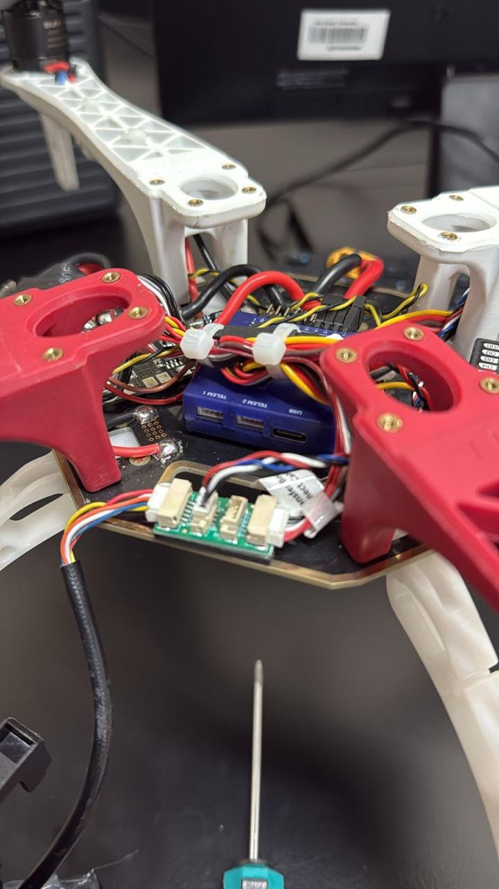
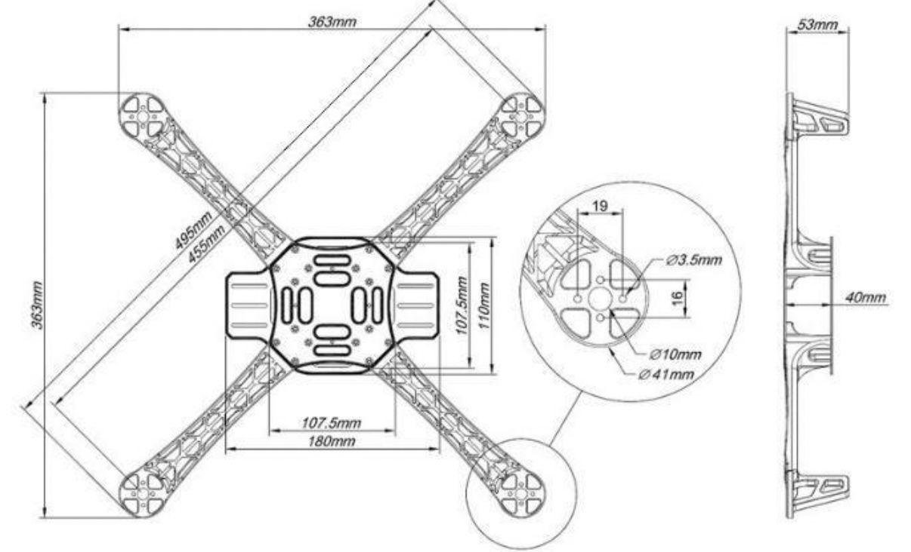
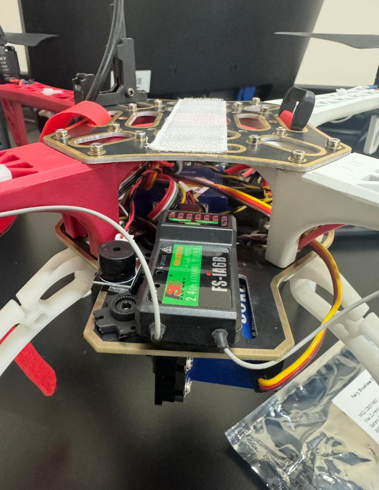
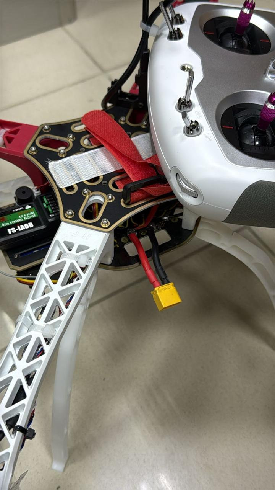
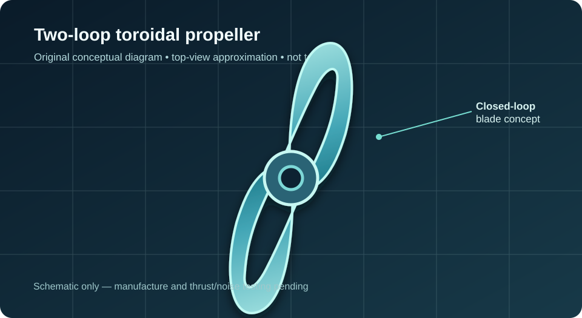
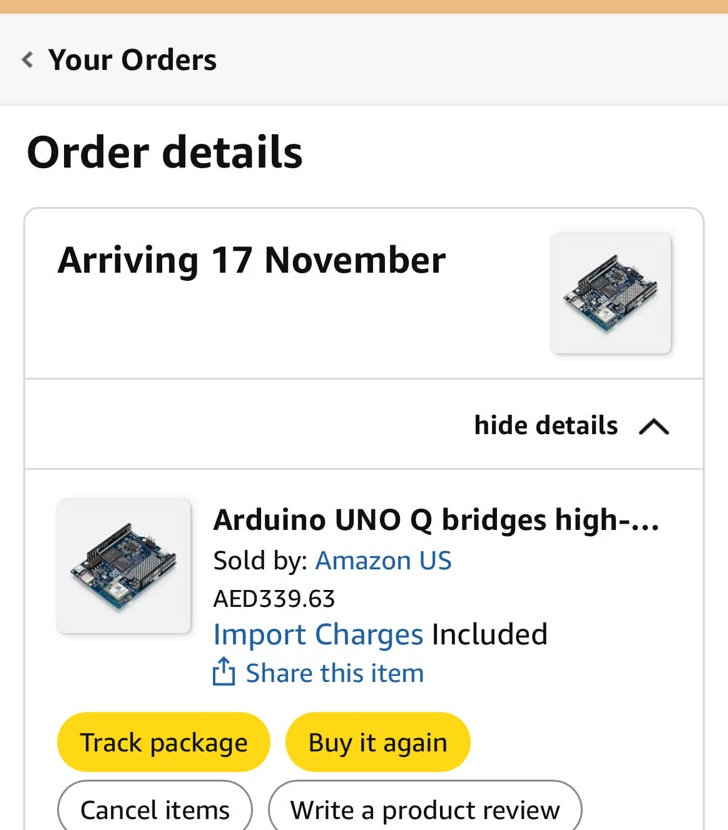
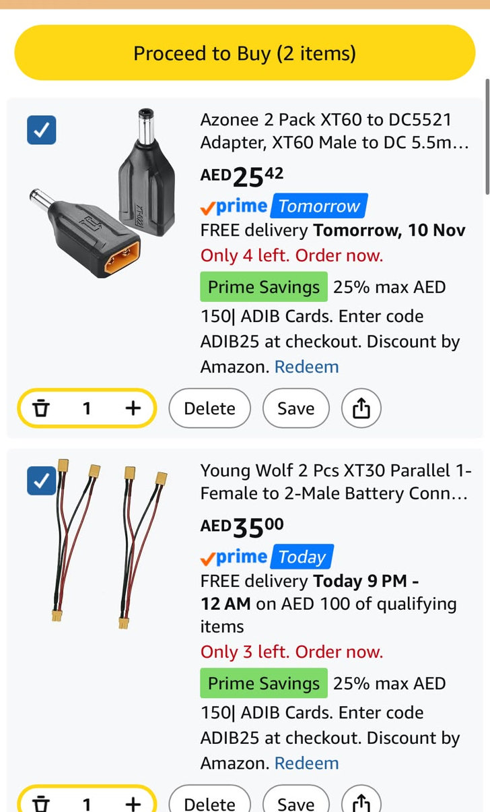

# Silent Wildlife UAV
### Low-Noise Quadcopter for Endangered Wildlife Detection and Monitoring

**Abu Dhabi University · College of Engineering · MEC 482 – Introduction to Mechatronics**  
**Project update: 9 November 2026**

> **Project goal:** Develop a low-noise wildlife-monitoring UAV that can detect endangered animals using onboard artificial intelligence, while minimizing acoustic disturbance and maintaining reliable thrust, flight control and energy efficiency.

*Figure 1. Actual assembled team quadcopter (9 November 2026). This is the current platform, not the previous winged hybrid VTOL model.*

**[View the latest progress presentation (PDF)](docs/Progress_Presentation_09Nov2026.pdf)**

---

## Home · Project team

| Team member | University email |
|---|---|
| Mansour Khalid Alnaqbi | 1086214@students.adu.ac.ae |
| Shamma Nasser | 1088805@students.adu.ac.ae |
| Alyazia Mohamed Alshehhi | 1090139@students.adu.ac.ae |
| Salim Mohamed Alkathiri | 1081901@students.adu.ac.ae |

**Project supervisor and course professor:** Dr. Claudio Vignola  
**Institution:** Abu Dhabi University

---

## Research question

**Can a quadcopter using optimized toroidal propellers and onboard animal-detection AI reduce acoustic disturbance during wildlife surveys while retaining sufficient thrust, usable flight endurance and reliable detection performance?**

Our investigation focuses on three measurable questions:

1. How do two-loop and three-loop toroidal propeller geometries compare for **noise, thrust and power consumption** under matched conditions?
2. Can the **Arduino UNO Q 4GB** run a YOLO-based animal-detection pipeline locally while the flight controller operates independently?
3. What total mass and measured power consumption are compatible with our **approximately 30-minute flight-time target**?

**Research hypothesis:** A suitably optimized toroidal geometry may reduce propeller noise while retaining useful thrust. This is a hypothesis, **not yet a measured result**.

---

## Biomechanics background and initial specifications

**Biological motivation:** Reduced disturbance to animals is central to the application. A specific biological mechanism transferable to our propeller or acoustic design still requires technical grounding and instructor approval to meet the course's *biomimetic* requirement. Toroidal geometry alone should not be called biologically inspired without evidence.

**Engineering principle:** Closed-loop toroidal blades change blade-tip vortex formation and acoustic behavior. They are **not silent**, and quieter operation cannot be assumed without acoustic testing.

| Item | Current selection or status |
|---|---|
| Platform | X-frame **quadcopter**, fully assembled and reported working |
| Chassis | Nominal **363 mm × 363 mm** span in provided reference drawing; verify on assembled hardware |
| Flight control | Existing flight controller, receiver, ESCs and motors |
| Flight planning | **Mission Planner**, predefined GPS waypoint routes (planned) |
| Onboard AI | **Arduino UNO Q (4GB)**, ordered 8 November; expected 17 November 2026 |
| Vision | Camera selection and installation **pending** |
| Animal detection | **YOLO** pipeline planned; implementation and accuracy not yet tested |
| Propellers | Two-loop and three-loop toroidal variants for evaluation |
| Manufacturing | SLS with proposed silicone infusion; carbon-fiber-filled polymer 3D printing |
| Endurance | **~30 minutes target**, not yet validated |

---

## Current X-frame quadcopter · Design and manufacturing

*Figure 2. Team-provided chassis reference drawing. The 363 mm reference dimension and detailed mounting dimensions must be checked against the actual frame.*

**Important design change:** We are **no longer using the earlier winged hybrid VTOL configuration**. The present prototype is the X-frame quadcopter shown in the assembly photographs.

### Actual assembly evidence

*Figure 3. Receiver, wiring and center mounting arrangement.*

*Figure 4. Current quadcopter with external radio transmitter and battery connection.*

**Completed:** Chassis assembly, existing flight-system integration and preliminary functional checks. Our team reports that the current drone is working. The onboard AI system and new toroidal propellers **are not yet integrated or flight validated**.

---

## System kinematics and dynamics

The current aircraft uses four rotors for lift, stabilization and control. A minimum ideal hover thrust per motor is approximately:

\[
T_{\mathrm{hover,motor}} = \frac{mg}{4}.
\]

The **earlier** project documented a 1.409 kg configuration, giving about 3.46 N per motor at hover. That mass does **not** establish the mass of the current redesigned quadcopter. The complete current mass must be measured before selecting propellers or claiming flight endurance.

We will calculate and check:

- **Thrust-to-weight ratio** at the actual assembled mass.
- **Motor power**, \(P=VI\), during controlled tests.
- **Thrust per watt** for each tested propeller.
- **Flight endurance**, using usable battery energy divided by measured average system power.
- **Frame and mount dimensions**, fit, vibration and structural suitability.

---

## Quiet propulsion · Toroidal propeller development

*Figure 5. Original, simplified schematic of a two-loop toroidal propeller concept. Not a manufactured blade or validated CAD geometry. [External GrabCAD reference](https://grabcad.com/library/toroidal-propeller-2-blades-1).*

We are comparing **two-loop and three-loop toroidal geometries**, together with two proposed manufacturing approaches:

| Manufacturing route | Proposed description | Key checks |
|---|---|---|
| **SLS with silicone infusion** | Laser-sintered polymer structure with proposed silicone treatment/infusion | Process feasibility, material bonding, balance, strength and surface finish |
| **Carbon-fiber 3D printing** | Carbon-fiber-filled polymer printed propeller | Strength, fiber orientation, mass, balance and surface finish |

**Planned fabrication:** Later in the week of 9 November 2026. Manufacturing and testing have not yet been reported complete.

### Preliminary concept selection (not experimental data)

| Criterion | Weight | 2-loop rating /5 | 3-loop rating /5 |
|---|---:|---:|---:|
| Acoustic noise | 30% | 4 | 3 |
| Thrust capability | 25% | 3 | 5 |
| Energy efficiency | 20% | 4 | 3 |
| Weight | 10% | 5 | 3 |
| Fabrication cost | 10% | 5 | 3 |
| Robustness | 5% | 3 | 4 |
| **Initial weighted score** | **100%** | **78/100** | **71/100** |

The scores above are **provisional engineering preferences**. We must not present them as thrust, sound or efficiency measurements. The final selection will use matched-condition testing.

---

## Electronics and autonomous control architecture

The project deliberately separates **flight control** from **wildlife image processing**:

| Flight system — existing | AI detection system — being added |
|---|---|
| Mission Planner creates the route | Camera captures images |
| Existing autopilot follows GPS waypoints | Arduino UNO Q runs compatible YOLO inference |
| ESCs and motors control the quadcopter | Detection boxes, confidence and timestamps are logged |
| Flight stabilization remains independent | Optional GPS data association; **no motor-control authority** |

**Conceptual mission:** Plan survey → execute authorized waypoint flight → camera captures footage → YOLO detects animals onboard → store detections → land and review data.

The aircraft's GPS provides **drone location**. Determining an animal's actual ground position requires camera orientation, altitude, calibration and georeferencing; these steps have **not yet been validated**.

### Guidance from external researcher

Following the Global Ocean Robotics Day at Sorbonne University Abu Dhabi, our team contacted researcher **Rawda Alsamahi**. She confirmed that her project used the **Arduino UNO Q (4GB)** for onboard YOLO-based detection and suggested considering processor dimensions, memory, inference speed and development tools. Her related paper was still under review at the time of correspondence (4 November 2026). This was valuable feasibility input, **not validation of our specific drone**.

---

## Arduino purchase and power integration

*Figure 6. Arduino UNO Q ordered 8 November 2026; estimated arrival 17 November. The displayed item price was AED 339.63 including import charges.*

*Figure 7. XT60-to-DC5521 adapter and XT30 parallel connector options. These were shown in the shopping cart, **not confirmed as purchased or electrically compatible**.*

### Power safety and integration

The proposed AI power system is intended to draw energy from a battery, **separate from control of the flight motors**. The voltage and connection method must be tested before powering the UNO Q.

According to the official Arduino power documentation, the UNO Q requires **regulated 5 V / 3 A via USB-C**, or **7–24 V DC through the VIN pins**. An XT60-to-DC barrel adapter does **not** by itself prove a safe connection to UNO Q. Confirm connector compatibility, correct polarity, fuse/protection, load capability and the selected power route before installation.

### Component status and documented costs

| Component | Status | Recorded amount |
|---|---|---:|
| Arduino UNO Q 4GB | **Ordered** | **AED 339.63**, item shown including import charges |
| XT60-to-DC5521 adapter | Shopping cart / proposed | AED 25.42 displayed |
| XT30 parallel connector pair | Shopping cart / proposed | AED 35.00 displayed |
| Compatible camera | Selection/purchase still to confirm | Not confirmed |
| Propeller prototypes | Fabrication planned | Quotation pending |

Previous chassis and flight-control components are being reused; their historical acquisition costs are not counted above. This is **not a complete project-cost total**.

---

## Detection software and data collection

Planned onboard pipeline:

1. Camera **image capture**.
2. **Preprocessing** and resizing suitable for the model.
3. **YOLO detection** and confidence thresholding.
4. **Tracking across frames** if the selected processor and model support the required speed.
5. **Local logging** of timestamps, detections and optional synchronized drone GPS.
6. Post-mission analysis on a computer.

We will compare performance with actual test footage, reporting frame rate, detection precision/recall where ground truth exists, and measured processor power. No claimed detection accuracy is currently available.

---

## Experimental plan · Verification

| Test | Method | Required evidence |
|---|---|---|
| Propeller noise | Fixed microphone position and matched thrust | dBA and ambient background notes |
| Propeller thrust | Guarded thrust test stand | N, RPM and supply power |
| Propeller comparison | At least 10 independently restarted trials per configuration | Mean, spread and normalized thrust per watt |
| AI inference | Known test images/video and recorded outputs | Detection metrics, frame rate, latency |
| Electrical supply | Voltage, polarity and current checks | Supply and wiring verification log |
| Endurance | Measured mass, energy and average flight power | Actual measured flight time versus 30-minute goal |
| Safety | Protected moving parts and emergency cutoff | Checklist and instructor approval |

**All new toroidal propellers must first be assessed in a guarded bench rig.** Flight use will require structural, balance, motor compatibility and supervisor approval. The MEC 482 brief additionally restricts uncontrolled free flight and normally expects low-voltage supplies; any exception requires instructor review.

---

## Project progress · 9 November 2026

| Work package | Status |
|---|---|
| Current X-frame quadcopter assembly | **Completed** |
| Existing drone control system | **Working**, team-reported |
| Chassis dimensional reference | **Available**; physical measurements to verify |
| Arduino UNO Q 4GB | **Ordered**; awaiting delivery |
| Camera + YOLO implementation | **Planned**, hardware pending |
| Battery connection components | **Options identified**, verify and purchase status |
| Toroidal blade CAD/manufacturing route | **Under development** |
| SLS/silicone and carbon-fiber prototypes | **Planned later this week** |
| Thrust/acoustic comparison | **Not yet tested** |
| Thirty-minute endurance | **Target only** |

### Immediate next steps

1. Receive the UNO Q; select a compatible camera and check power requirements.
2. Fabricate the proposed toroidal prototypes and document settings.
3. Compare thrust, acoustic noise, energy demand and structural integrity on a protected rig.
4. Run a verified YOLO model with local detection logs.
5. Integrate, measure actual system mass and power, and evaluate endurance.
6. Complete the instructor-approved biomimetic mapping, safety checks and final validation.

---

## Presentations and project documents

**[Download progress presentation, 9 November 2026 (PDF)](docs/Progress_Presentation_09Nov2026.pdf)**

Future CAD drawings, software files, raw trial data, uncertainty calculations, photographs and updated reports will be added to this repository as they are produced.

---

## References and technical links

1. [MIT Lincoln Laboratory — Toroidal Propeller](https://www.ll.mit.edu/partner-us/available-technologies/toroidal-propeller-0)
2. [Arduino — UNO Q product and hardware](https://store.arduino.cc/products/uno-q)
3. [Arduino — UNO Q power specifications](https://docs.arduino.cc/tutorials/uno-q/power-specification)
4. [Arduino — USB camera documentation](https://docs.arduino.cc/hardware/usb-camera/)
5. [ArduPilot — Mission Planner](https://ardupilot.org/planner/)
6. [Ultralytics — YOLO documentation](https://docs.ultralytics.com/)
7. [GrabCAD — Toroidal propeller community design reference](https://grabcad.com/library/toroidal-propeller-2-blades-1)
8. *Structural Evaluation and System Integration of a Hybrid VTOL Drone for Offshore Search and Rescue* — previous team research manuscript, used as background only; **the current aircraft is a different X-frame quadcopter**.
9. Alsamahi, R. (4 November 2026). Personal research correspondence regarding UNO Q and onboard YOLO processing. Unpublished correspondence, summarized with acknowledgment.

---

**MEC 482 · Silent Wildlife UAV**  
**Supervisor and course professor: Dr. Claudio Vignola**  
**Abu Dhabi University · United Arab Emirates**
